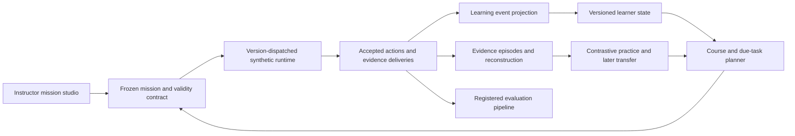

# AI and training transformation: learn to obtain evidence, explain decisions and transfer

Research/design snapshot: **24 October 2026**. Actual checkout inspected at
`8f6d6f18d7cabc1d490e31b60e0b5fe05efdeeed`, branch
`feature/vyuha-next-generation`, with concurrent R01 and assessment-generation
UI work preserved. This document proposes a replacement learning architecture;
it does not claim that the proposed systems are implemented or effective.
No source code, participant records or tests were changed/run for this research.
External papers/docs/source were read, not installed or executed.

The product direction is one continuous experience:

**Orient → form a provisional explanation → request evidence → revise or abstain
→ decide → reconstruct what was available → practise a meaningful contrast
→ return later to an unseen task.**

The three coordinated transformations below change the actual training task,
the Academy journey and instructor authoring. They are not three new diagnostic
panels. Graphics and XR should express this learning loop, using the same
mission, evidence and accepted-action contracts described in the other
transformation documents.

## What exists, and why it is insufficient for that experience

The current foundations are stronger than “a basic simulator with a chatbot.”
They should be retained where their contracts are sound.

| Inspected implementation | Current capability | Architectural limit to resolve |
|---|---|---|
| `server/learning.py`, `server/config/learning-v1.json` | Frozen catalog/context; individual C01–C05 and separate Crew C06; disjoint practice/assessment pools; practice does not mint individual assessment credit. Evidence derives from reconstructed decisions; unavailable evidence can be unassessable. | Catalog selection and completed-contact votes do not represent a trajectory of hypothesis, evidence request, misconception, remediation and independent transfer. Five individual competency definitions are not interchangeable with the four legacy Director skills. |
| `client/src/Academy.tsx`, `GuidedDecision.tsx`, `LearningEvidence.tsx`, `server/learning_reflection.py` | Full/faded guidance, practice preparation, original evidence and learner-authored, hash-bound reflection. | A lesson selector, guidance fade and post-session notes are not yet a coherent course that changes the next task according to a validated learning need. Saving an explanation does not establish that it is correct, understood or transferred. The current trusted-LAN identity model does not guarantee privacy from administrators or other users with data access. |
| `server/fusion.py`, client Fusion implementation | Sanitized current observations, explicit limitations, assessment-disabled advice and server-reconstructed exposure receipts. Heuristic scores are correctly labeled as uncalibrated; RF silence/no reply do not establish hostility. | There is no authored pedagogical strategy, assessed explanation of the learner's misconception, or evaluated assistance trajectory. Exposure validation establishes a model/input boundary, not human viewing or cognitive reliance. Preserve this boundary rather than replace it with unconstrained language generation. |
| `server/director_v2.py`, `server/learning.py:choose_item` | Seeded inspectable policies: four-skill Beta draws with fixed coefficients and processed-session gaps; separate learning selector prioritizes coverage/error with recency filtering. | Neither policy estimates elapsed-time forgetting or an intervention's learning effect. Recency filtering can compete with coverage. Engine-derived outcome accuracy does not fit a human learning model. |
| `server/models.py:Action`, sensor/engine modules | Accepted decision actions are `designate`, `classify`, `engage`; classification requires a kind and identity. Passive delivered observations are versioned and reconstructed. | The authoritative action vocabulary does not yet contain a trainee evidence request or explicit recorded uncertainty decision. A visual inspection control must not be presented as a new evidence-producing action unless the engine actually implements it. |
| `server/review.py`, `review_models.py`, `counterfactual.py`, `client/src/Ghost.tsx` | Per-decision observations, reference truth, reason codes, consequences, context commands, timeline and immutable hypothetical branches. Ghost labels pinned decision evidence versus moving playhead. | A review contains important facts, but the trainee still has to assemble an explanation across views. A same-stage action replacement followed by replaying later recorded actions is a specific simulated intervention, not an optimal alternative policy or a real-world causal estimate. |
| `server/controlled_study.py` | Frozen consented full-versus-faded protocol; baseline/practice/immediate/delayed/transfer phases; terminal dispositions; missingness and exposure eligibility. | This protocol explicitly does not compare adaptive versus baseline curricula or establish empirical form equivalence. New interventions need a new registered protocol/estimand, not a relabeling of current descriptive reports. |
| `server/assessment_obligations.py` | Bounded C01 generation/opportunity receipts, frozen sources, invalid/exhausted/valid ambiguity and explicit not-evaluated scope. | Passing one passive detection window is not classification support, human solvability, difficulty equivalence or a validated assessment bank. The receipt is an authoring primitive for the future system, not that system's completion. |

## New evidence, with its actual strength and reuse limits

These references extend the earlier Numbas/XState/Inspect continuation. ECD is
retained only because it supplies a necessary architecture principle; the
earlier source inventory is not rerun. Access dates are 24 October 2026.
“Paper result” below means reported by the authors, not replicated in VYUHA.

| ID / primary source | What was verified; what it does not establish | Licensing / reuse boundary |
|---|---|---|
| **AI01 — [ETS RR-03-16, Evidence-Centered Design](https://www.ets.org/research/policy_research_reports/publications/report/2003/hsgs.html), with [publisher abstract](https://onlinelibrary.wiley.com/doi/10.1002/j.2333-8504.2003.tb01908.x)** | Framework links claims about latent competence to observable performance and task design. Architectural justification, not a randomized trial of VYUHA or a ready-made scoring model. | ETS/publisher material; no permissive software/content reuse grant established. Independently implement the ideas; do not import diagrams/item content. |
| **AI02 — [CTAT authoring tutorial](https://cdn.ctat.cs.cmu.edu/CMUCTAT/CTAT/docs/tutorial-example-tracing.html), [maintainer home](https://cdn.ctat.cs.cmu.edu/CMUCTAT/CTAT/docs/)** | Documented example tracing: demonstrate alternatives, incorrect paths and hints. The tutorial explicitly shows a legitimate unrecorded solution being unrecognized. Working-system documentation, not proof that our future tutor recognizes every valid strategy. | Maintainer says free for research. A general permissive commercial code/content license was not verified; concept reference, no dependency/code import. |
| **AI03 — [Whyline, author-hosted CHI 2004 paper](https://faculty.washington.edu/ajko/papers/Ko2004Whyline.pdf)** | Questions about output connect to relevant execution events. The exploratory iterative study used four participants without/five with; it is neither a modern large RCT nor simulation-learning evidence. Inspires an interrogable AAR, not a borrowed effect-size claim. | ACM copyright; limited personal/classroom copying permission appears in paper. No general code/artwork reuse permission inferred. |
| **AI04 — [Bastani et al., PNAS 2025](https://doi.org/10.1073/pnas.2422633122), [author full paper](https://hamsabastani.github.io/education_llm.pdf)** | High-school mathematics RCT: assisted practice improved, while unrestricted-style GPT Base hurt subsequent unaided exam performance; guarded GPT Tutor removed that harm without establishing a positive unaided effect. Educational outcomes in that context, not our domain. | Published paper **CC BY-NC-ND 4.0**, shown by publisher. Data/code are separate; no prompt/dataset reuse assumed. |
| **AI05 — [Tutor CoPilot v3, 10 October 2026](https://arxiv.org/html/2410.03017v3), [demo repository](https://github.com/rosewang2008/tutor-copilot), [license](https://raw.githubusercontent.com/rosewang2008/tutor-copilot/main/LICENSE)** | Revised paper reports tutor-randomized K–12 mathematics results: +4 percentage points on session exit tickets; end-of-year improvement was not statistically established. Students could meet tutors from different conditions. Current paper's sample is over 700 tutors/1,000 students; older README counts differ. Instructor-facing support has a credible precedent, not automatic adult transfer. | Paper **CC BY 4.0**; tutorial code **Apache-2.0**. Student data are restricted by district agreement, not licensed with the repository. |
| **AI06 — [Liu et al., IZA DP 18989, October 2026](https://www.iza.org/publications/dp/18989/the-effects-of-course-integrated-ai-tutoring-on-student-performance-and-engagement-a-randomized-university-trial), [full working paper](https://docs.iza.org/dp18989.pdf)** | Instructor-randomized study, 2,379 students/30 instructors. Exact-course-match analysis reports adverse grades/participation; full-sample adverse grade evidence is not significant. Uptake was low and inference used few instructor clusters. Preliminary evidence against treating deployment or engagement as efficacy; not a universal anti-tutor result. | Series identifies work as preliminary/revisable; copyright retained by authors. No permissive dataset/software reuse grant established. |
| **AI07 — [pyBKT paper v2](https://arxiv.org/abs/2105.00385v2), [maintainer implementation](https://github.com/CAHLR/pyBKT), [license](https://raw.githubusercontent.com/CAHLR/pyBKT/master/LICENSE)** | Fits latent learning/forgetting/slip/guess variants; paper checks simulated parameter recovery and real-log prediction. Candidate reproducible baseline, not evidence that predictions improve a VYUHA curriculum or certify mastery. | Core code **MIT**; bundled dependencies/data need separate review. Optional offline research tool, not a new browser/runtime requirement. |
| **AI08 — [DAS3H, EDM 2019 paper](https://arxiv.org/html/1905.06873v1), [author implementation](https://github.com/BenoitChoffin/das3h)** | Multi-skill/time-window response model reports predictive improvements on three educational datasets. Its discussion motivates future scheduling; those comparisons are not an intervention trial showing superior retention under the proposed scheduler. | Paper **CC BY 4.0**. No reuse license established in the inspected repository root/README; do not import its code by assuming the paper license covers it. |
| **AI09 — [Ghasemi/Topcu, CDC 2019 active perception](https://arxiv.org/abs/1910.02130v1)** | Limited-budget information-source selection, theoretical assumptions and robotic-navigation simulations. Shows a formal model for useful sensing; provides no human training, calibrated sensor or VYUHA policy guarantee. | arXiv links its nonexclusive distribution license, not a general reuse grant. Method reference, no paper/code redistribution assumed. |
| **AI10 — [JuliaPOMDP simulation standard](https://juliapomdp.github.io/POMDPs.jl/stable/simulation/), [license](https://raw.githubusercontent.com/JuliaPOMDP/POMDPs.jl/master/LICENSE.md)** | Separates simulator state, observations, belief updates and policy actions in a specified loop. Documented implementation contract, not an educational result. Useful as an architectural check on information boundaries. | Core **MIT**; organization explicitly warns that other packages may differ. No Julia migration is required. |

The practical inference is architectural: **tutor content, action opportunities,
assistance exposure and independent outcomes belong to the same designed
learning intervention**. A more fluent answer generator or a better response
predictor alone is an insufficient replacement for that intervention.

## Flagship 1 — Evidence Reconstruction Theatre and contrastive practice

**Level 4 product transformation**, assembled from existing authoritative data
and a redesigned learner workflow. Initial implementation can retain the current
engine and score semantics.

**Current insufficiency → external proof.** Ghost already has verified
per-decision facts and branches, but requires cross-view reasoning. AI03
demonstrates question-to-execution interaction as an implementable pattern;
AI01 requires an explicit evidentiary argument. Neither proves educational
benefit from our proposed presentation.

**Target capability.** On opening a completed exercise, the trainee enters a
spatially and temporally synchronized case. Select “Why was this decision
unsupported?” or “What evidence was missing?” and follow the observation,
availability, declaration, accepted decision, rule and consequence. Before
revealing reference truth, the trainee can commit a prediction and cite an
observation. A modeled alternative remains visibly separate; a new practice
case asks the same reasoning question with changed surface details. Instructor
review opens the same case, with authorized reference layers and attribution.

**Technical contracts.** A proposed `EvidenceEpisodeV1` contains immutable
session/scenario/review hashes, decision ID, accepted-order boundary, evidence
tick, playhead tick and allowed view scope. A derived graph distinguishes
`observed_input`, `accepted_action`, `rule_application`, `modeled_consequence`,
`temporal_context` and `hypothetical_intervention`. Links name their source
fields and rule version; temporal proximity alone cannot become a mechanism
edge. No LLM invents nodes or resolves missing facts. Existing reference truth
is access-controlled and labeled as reference; instrument availability does
not prove a human saw or understood it. An explanation beyond stored/replayable
facts says “not established.”

That access-control sentence describes the target architecture. Current
completed AAR records already contain reference truth: a client reveal switch
is an instructional presentation boundary, not a server privacy guarantee.
The first theatre slice is after-exercise review with explicit reference
answers in its inspector. A genuinely blinded assessment/review mode would
need a separately scoped server projection and a new delivery contract.

The existing `branch` semantics must be displayed: one same-stage action is
replaced, later recorded actions are attempted when valid, and the original
remains unchanged. A future policy-controlled branch gets its own continuation
policy/version and cannot masquerade as the current intervention. Historical
data lacking enough detail gets a partial graph, not invented observations.

**User benefit → acceptance.** Users should answer evidence-location and
why/why-not questions with less navigation and fewer wrong-time inferences.
Predeclare five matched review tasks; collect baseline completion time,
factually wrong explanations and keyboard/panel transitions. A provisional
usability target is 30% lower median completion time without worse correctness;
this is a product target, not a reported result. Engineering acceptance checks
exact fact/ID correspondence, absent/future/stale evidence, cross-session
isolation, reference-view gating and original branch immutability. Follow with
an unassisted unseen reasoning task; a satisfying replay alone is not learning.

## Flagship 2 — Active Evidence Missions

**Level 4 task/engine transformation; Level 5 for validated policy-sensitive
curriculum generation.** This changes what the trainee can do rather than
adding another sensor explanation.

**Current insufficiency → external proof.** Current decisions largely consume
passive observations. AI09 formalizes budgeted information gathering, while
AI10 separates hidden simulation state from a policy's observations. These
support an implementable design direction; no solver's theoretical guarantee
is inherited under VYUHA's different assumptions.

**Target capability.** The trainee chooses a useful check: request an authorized
observation, wait for its delivery, compare time-valid cues, reconsider a
hypothesis or explicitly retain uncertainty. Some missions make another check
useful; others make it uninformative or unavailable. Completing a task means
justifying a decision or a legitimate abstention under its declared evidence
conditions. Sensor action costs are illustrative instructional constraints,
not operational optimization or real-world equipment advice.

**Technical contracts.** Introduce a new action/observation contract under a
new engine version; `vyuha-0.5.0` is a **design placeholder, not an implemented
release**. An `EvidenceRequest` carries session/actor/role, idempotency key,
accepted tick/order, observed contact reference and whitelisted query type.
The engine records request acceptance, scheduled delivery, delivered sample
time, availability, evidence ID and any explicit refusal. At a logical tick,
declare the ordering of instructor changes, prior due deliveries, new requests,
decision actions and publication. Cross-language implementations follow that
same order. A client cannot refresh old evidence, skip wait time, request an
unobserved canonical target or farm duplicate observations for credit.

Add an explicit `uncertainty_decision`/abstention record with a declared
question and cited evidence, distinct from no action, network loss or an
engagement `hold`. Exact vocabulary and scoring require a reviewed new
assessment contract. Preserve existing decisions and scores in historical
engines; do not reinterpret old no-click intervals as rational abstention.
Desktop, XR, offline playback and Crew all use this accepted command path;
only the initiating role receives individual attribution.

The first authored set should include pairs of synthetic worlds with identical
visible prefixes but different references. A permitted query distinguishes
some pairs; others intentionally remain unresolved. Freeze that equivalence
claim over the declared observation abstraction and bounded horizon. A
hidden-state authoring oracle may validate the set offline; live tutoring must
see only the trainee-visible projection. This separates task creation from
answer leakage.

**User benefit → acceptance.** The learner should practise choosing evidence,
not guessing a latent label from trajectory familiarity. Compare inquiry
selection, unsupported confident decisions, justified abstention, time-to-useful
evidence and unnecessary requests across held-out semantic families. Fewer
requests alone are not success. Engineering acceptance requires exact Python/
TypeScript scheduling parity, duplicate/delay/disconnect/role-change handling,
no early evidence, and paired-world indistinguishability where declared.
Human studies must establish whether the new actions teach transferable
reasoning rather than a peculiar game mechanic. Physical sensor fidelity is a
separate model-validation question.

**Concrete authored lesson.** Two synthetic contacts initially have the same
generic silhouette and no current affiliation evidence. The trainee states
what remains unknown, then chooses an available registration check. In one
case it supplies a time-valid civil cue; in the other the check is unavailable.
The lesson's correct reasoning is to cite the cue where it exists and retain
uncertainty where it does not—not to infer hostility from the unavailable
result. The theatre then reconstructs request/sample/delivery/decision order.
Academy next offers a changed-surface case with stale evidence or conflicting
channels, and later an independent held-out family. The instructor authors
these connected learning opportunities and their permissible conclusions,
rather than manually choosing a visually similar raid for each screen.

## Flagship 3 — A longitudinal Academy learning runtime and instructor mission studio

**Level 4 architecture/workflow transformation.** Prediction-driven scheduling
is an experiment inside this product, not a prerequisite for shipping a
coherent authored course.

**Current insufficiency → external proof.** The Academy, Director and study
systems currently represent different units of evidence. AI02 makes alternate
solution paths and remediation concrete; AI07/AI08 provide inspectable model
alternatives, while AI04/AI05/AI06 explain why assisted success and deployment
usage cannot substitute for independent learning outcomes.

**Target capability.** Academy becomes a mission journey: an orientation case,
guided contrast, independent case, reconstruction, a targeted retry and later
retrieval/transfer. The instructor designs a whole learning objective and its
legitimate routes in one studio, not separate unrelated scenario, hint and
assessment forms. A trainee sees “what to practise next and why” with the
specific evidence behind that recommendation. Instructors can distinguish an
unavailable opportunity, unsupported inference, assistance-supported success
and independent performance.

**Technical contracts.** A content-addressed `MissionContractV2` packages:

- Claim/competency IDs and ontology version; explicit observation opportunities,
  allowed uncertainty, prerequisite hypotheses and task-role attribution.
- A finite instructional graph: two or more legitimate solution orders where
  applicable, misconception/remediation transitions, bounded retries, completion
  requirements and evidence references. Unsupported alternatives become
  `unrecognized-path`, not an automatic learner error; instructors can review
  and version the graph.
- A task family and semantic fingerprint built from evidence conditions,
  decision opportunities and confusable hypotheses; surface appearance/seed
  alone do not establish novelty. Separate practice, retention and transfer
  families, with explicit exposure/retirement records.
- Assistance policies and exposure recording. A deterministic pedagogical
  selector chooses an authored move—request a prediction, compare two cited
  observations, explain one missing link, propose a retrieval case—before any
  optional language realization. Assessment excludes tutoring by construction.
- Engine/action/observation/rubric/model versions, source and rights manifests,
  frozen parameters, validity checks and allowed accommodations.

The new append-only `LearningEventV2` records event ID, pseudonymous learner or
Crew role, accepted session boundary, mission/evidence IDs, opportunity ID,
assistance exposure, observed response, rubric version, assessability and
completion wall time. One accepted event cannot be duplicated into multiple
independent mastery votes. Missing/unavailable/unrecognized are separate
states; narrative quality and number of reflections are not competency credit.
Practice-process events may inform recommendations, while demonstrated
assessment performance remains a separate reporting stream. Crew evidence
does not become individual credit without an attributable assessed role task.

A `LearnerStateV2` is a replaceable derived projection with training-data scope,
model/parameter hashes, uncertainty and explicit evidence support. It never
edits legacy Beta profiles or old competency observations. Start with a
transparent authored progression plus elapsed-time due dates. Evaluate simple
frequency/recency and logistic baselines, then BKT variants or a time-aware
multi-skill model. Do not collapse correlated per-contact decisions into
independent binary items just because a package expects that format. A fitted
model can stay in shadow mode while the authored course ships.

Optional generative tutoring belongs behind a constrained `TutorMoveV1`:
strategy ID, allowed evidence IDs, accepted-prefix boundary, permissible claims,
help level and mission-state transition. The deterministic instructional policy
chooses that move; a language model may phrase it. Student text and retrieved
material remain untrusted data, not authorization to change scope. Validate
citations, version/session ownership and allowed claims, then fall back to
authored text on invalid output, timeout or missing context. Log proposed and
delivered text separately. A source ID attached to a fabricated claim is not
grounding, so exact evidence-consistency cases and expert review are necessary;
automated citation checks alone do not settle explanation quality. Teach-back
or an unseen task, rather than a tutor's self-rating of the learner, supplies
the independent outcome. Instructor-facing suggestions can precede direct
trainee dialogue, with the human choosing whether to deliver them.

**User benefit → acceptance.** A new learner should finish one coherent mission
and understand the next step without navigating four independent setup pages.
An instructor should author, preview and freeze one objective with two valid
paths and a remediation path in the same workspace. Measure journey completion,
setup mistakes, time to publish a valid mission, unresolved-path rates and
unassisted delayed/transfer performance. Provisional usability target: halve
cross-page setup steps and reduce instructor corrections, measured against the
current matched task. No predictive model gets production control merely
because it beats synthetic outcomes or in-sample accuracy.

## Target architecture and migration

Keep the layers small and local; the diagram is a contract separation, not a
demand for cloud microservices. Immutable mission assets and event projections
can remain in the existing deployment/database. No live model training or
remote account is required for the baseline experience.

Migration proceeds in four explicit steps:

1. **Reconstruct current history without changing it.** Produce source-linked
   evidence episodes from existing reviews. Keep missing historical fields
   missing. Launch the theatre as a replacement review experience with a legacy
   fallback, not an extra bottom-of-page panel.
2. **Ship one authored learning journey on current engines.** New mission IDs
   point to existing frozen scenarios; assistance/process events use separate
   tables. Validate alternate paths and assessment isolation. Historical exports
   remain readable; imported evidence retains original engine/catalog scope.
3. **Add active evidence under a new engine and capability gate.** Extend both
   authoritative implementations, accepted transport, offline replay and Crew
   attribution together. A legacy engine rejects new action types rather than
   ignoring them. The new engine stores a new rubric alongside the old score,
   without recalculating historical totals.
4. **Evaluate and promote a scheduler, then consider a language model.** Freeze
   policies and datasets, compare in shadow/offline evaluation, then a new
   consented intervention protocol. Local deterministic tutoring is the fallback.
   A language model realizes approved pedagogical moves from sanitized evidence;
   it receives no hidden roster or scoring oracle and has no action/credit API.

## Validation that can justify promotion

| Claim being considered | Evidence required | Evidence that is insufficient |
|---|---|---|
| Correct reconstruction and information boundary | Focused fixtures for missing/future/stale evidence, IDs/order, scoped truth, legacy replay, role ownership and supported explanation links | A screenshot, fluent prose, or an engine's complete internal state |
| More usable/understandable experience | Matched browser tasks, keyboard and XR-specific interaction evidence, wrong-time/error rates, loading/frame costs and accessible alternatives | A more impressive scene or lower click count with lower correctness |
| Better next-response prediction | Learner-held-out and later-time evaluation; family-held-out transfer check; NLL/Brier/calibration and abstention coverage; assistance/missingness separated; simple baselines | Random row split, in-sample AUC, synthetic agents as human substitutes |
| Better instructional policy | Prospective randomized comparison of the complete intervention, unaided endpoint, declared allocation/contamination/missingness analysis and adequate precision | An accurate predictor, more practice completion, aligned advice or positive preference |
| Retention/transfer or equitable performance | Delayed unassisted probes, truly held-out families, supported subgroup analyses/uncertainty and opportunity availability | Repeated seeds, structural form balance, a universal “fair” badge |

The current full-versus-faded study protocol remains a historical protocol.
Register a new policy comparison with the intervention versions, teaching-time
budget, fixed endpoint and held-out-family exposure rules. Retain every
allocated participant in disposition reporting; no imputed zeros for missing
phases. Separate inference about local synthetic decisions from real-world
readiness. Collect only consented data needed for these learning questions;
do not add physiological profiling or inferred personal attributes merely
because an AI model could consume them.

## Dependency-ready first implementation

Build the **Evidence Reconstruction Theatre for one completed C02 case** with
an observation-only explanation path, a labeled reference reveal and an
explicit current-branch semantics view. The source already contains the
required decision/evidence/reason IDs. Use a single `EvidenceEpisodeV1`
presentation contract across trainee review and instructor selection. Verify
fact identity, temporal boundaries, missing evidence and unchanged original
payloads; run real browser why/why-not tasks. This is a visible Level 3 first
increment toward the Level 4 theatre, not completion of the learning system.

In parallel, author the first mission's claim/evidence/task contract and valid
alternative trajectories. Defer new engine behavior until its evidence-delivery
contract is reviewed and parity-ready. Do not make another generic chatbot or
diagnostic panel the next strategic deliverable.
