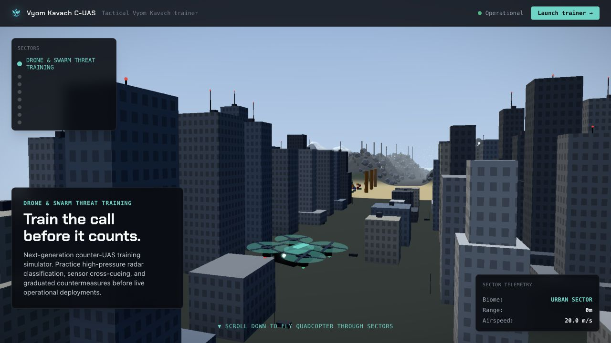
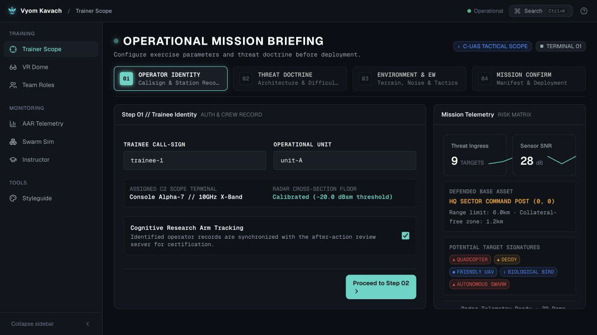
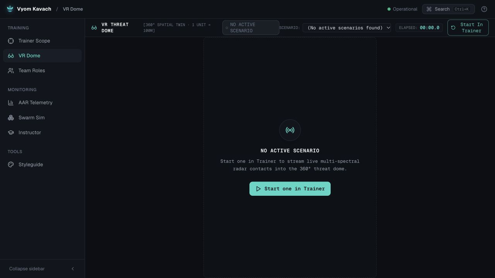
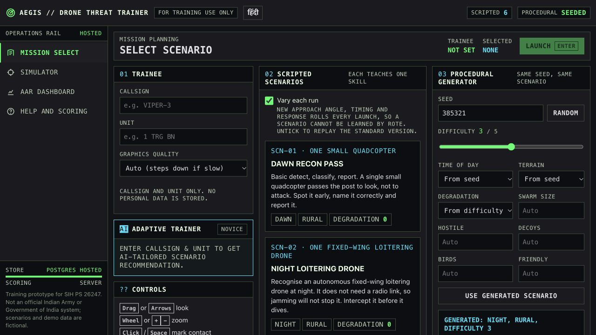
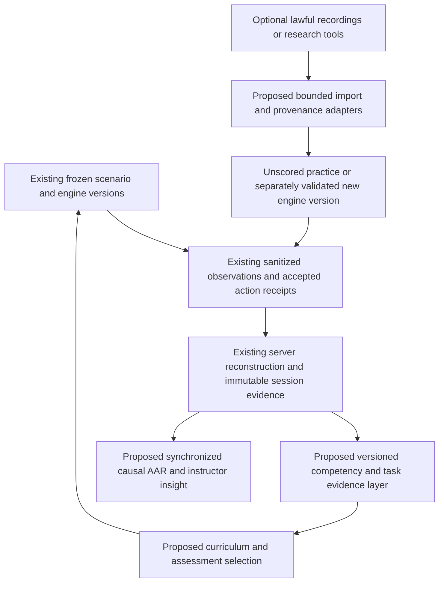

# VYUHA: deep competitive research and next-generation strategy

**22 October 2026 · research only · baseline main `2d90137e8116075cd1e48eadab64cb306ea12278`**

## 1. Conclusion and strategic direction

VYUHA should evolve from a capable, auditable simulator into a **measurably effective training system**. A major established strength in the inspected public landscape is its combination of deterministic versioned simulation, authoritative reconstruction, historical compatibility, Crew attribution/isolation, recoverable evidence and shared browser/VR actions. Other inspected projects also implement shared cores, server scoring or adaptive learning; no uniqueness claim follows. Its biggest opportunities are a coherent curriculum, defensible proficiency evidence, richer observation-centered practice and smoother first-use performance.

That is a source- and evidence-based judgment, not an overall competition ranking. No matched trial, price comparison or human learning experiment was conducted across products. Several external projects are stronger in specific inspected areas—guided lesson structure, bilingual communication, raw-signal educational displays, parameter provenance or scenario authoring. Some professional systems advertise much greater environment and hardware scope; their deployments, costs and performance were not tested here.

The recommended first step is **not** another redesign or engine replacement. Preserve the integrated spatial workstation and 3D theatre. Add a shared competency/evidence layer, tighten interaction and deployment reliability, and instrument a learning pilot. Only then expand the ambitious sensor, authoring, tutoring and immersive capabilities in the [40-item roadmap](ROADMAP.md).

## 2. What was verified before comparison

`origin/main` was fetched and its merge inspected. Main `2d90137` has parents `6546816` and completed unified `f5cf3e8`; its tree is identical to `f5cf3e8`. The existing exact-runtime evidence is for `ad430f7` with source-input hash `f87104f8…36534a`. Existing records report **712 backend / 367 frontend** tests, historical 18/22 scorecards, browser/IWER, recovery, transfer, scoped security, Docker and clean-clone checks. These tests were **not rerun today** and do not establish physical headset or final-candidate platform acceptance. [Baseline and actual source references](BASELINE.md).

The roadmap does not mistakenly call Crew history, expiring codes, finite ammunition, delayed effects, EO/IR, What-If, reference replay, action receipts or VR “missing.” They exist. We inspected the relevant implementation and current evidence rather than carrying forward earlier audit assumptions. Conversely, README and feature-manifest text contain older checkpoint information beside newer evidence; source-grounded documentation reconciliation is a real maintenance opportunity.

## 3. Public competitor landscape

Six complementary GitHub queries produced **94 unique entries**. We retained VYUHA plus **68 other repositories for screening**: **64 trainer-related/possible entries and four adjacent/other-scope entries**. Another 25 broad keyword matches have explicit triage dispositions. These counts are not independent verified teams. There are related legacy repositories, an apparent StarBusters family, a companion model repository, thin placeholders and one entry without a pinned source tree. All are listed with exact commits and evidence level in the [inventory](COMPETITOR-INVENTORY.md).

### Most useful comparison clusters

| Cluster | Concrete public examples | Useful evidence | What must not be inferred |
|---|---|---|---|
| Sensor/AI laboratories | VyomKavach; Ashutosh trainer; GARUDA AEGIS; AERIS ZeroCoders | Synthetic DSP/model pipeline, bounded language authoring, multi-target filters, learned synthetic baseline source | Real sensor calibration, operational detection accuracy or better training outcomes |
| Structured learning / provenance | PARASHURAMA; AVLON; DronAcharya; unrelated `codewithsid2256/Vyuha` | Four-lesson coach, fading practice; BKT source; value/source/note data pack | Empirically fitted mastery or recognized certification |
| Full workflow / local usability | ammar AEGIS; AERIS Axion; Godot trainer; AEGIS-X | Scoring/rubric source, reports, keyboard/audio patterns, local packaging documentation | Matched device performance or secure LAN operation merely from “offline” wording |
| Breadth with uneven integration | SUDARSHAN; DroneShield; SKYHAWK; SKYSHIELD | Large UI/catalog/engine trees and explicit build notes or fallbacks | Every visible screen is backed by real persisted training or every “AI” result is evidence-grounded |
| Focused / adjacent / early artifacts | DRISHTI, Trinetra variants, NEOSIM, AAR dashboard, AEROSHIELD, TRISHUL-SIM, remaining entries | Specific source, architecture, documented scope and sometimes narrow demo artifacts | That a model notebook, ROS scaffold, screenshot or README proves an end-to-end product |

**Two AERIS projects and multiple Trinetra projects are separate repositories; the unrelated Vyuha is not this VYUHA.** Similarly named commercial counter-drone hardware is not evidence for the supplied student VyomKavach service. These distinctions matter more than a superficial logo/name comparison.

## 4. Supplied VyomKavach: detailed investigation

### Identity and access

- Supplied service: [vyomkavach-api-sw9g.onrender.com](https://vyomkavach-api-sw9g.onrender.com/).
- Public API schema: [OpenAPI](https://vyomkavach-api-sw9g.onrender.com/openapi.json).
- Matching repository: [AncientWarRior13/Vyom-Kavach-sih26247 at b2e89e39](https://github.com/AncientWarRior13/Vyom-Kavach-sih26247/tree/b2e89e39620fa3238b697ac5a59219739ad80f95). Its README links this API and a Vercel frontend.
- No root license detected in the pinned tree. Reference-only; no code, model or assets were incorporated.

The service returned HTTP 200 through validated system TLS. The initial Python CA failure was a local fetch issue, not evidence that the service was down.

### What was actually observed

The landing page rendered an urban 3D scene and training navigation. “Launch trainer” opened a four-step preparation flow covering identity, threat selection, environment and confirmation. The setup displayed a research-tracking choice preselected. We did not enroll, enter personal data or start a shared server exercise. Its VR page loaded, but displayed no active scenario. That verifies a route and empty state, not functioning immersive headset training.

Public schema paths describe classification/sensor/response, team actions, Instructor injection/degradation, AAR/trends/replay/taxonomy/heatmap/certification and research endpoints. **Schema exposure is not a workflow pass.** No private trainee histories were read and no state-changing endpoints were invoked.

A safe GET of `/api/model/status` returned `state: idle`, `last_trained_at: null`, `last_error: null` and an ONNX path. This does not establish that inference loaded successfully, failed, or met advertised latency; it is training-status metadata. [Observation receipt](evidence/live-observations.json).

### Source findings and limits

| Area | Inspected source supports | Qualification and VYUHA implication |
|---|---|---|
| Radar AI | [`radar_classifier.py`](https://github.com/AncientWarRior13/Vyom-Kavach-sih26247/blob/b2e89e39620fa3238b697ac5a59219739ad80f95/ml_bridge/radar_classifier.py) contains ONNX Runtime loading, feature order/classes, classification and explicit heuristic fallback. | Real inference code exists; deployed model path, latency, calibration and out-of-distribution performance were not measured. VYUHA could add a separately validated local assistant benchmark rather than relabel its heuristic probabilities. |
| Synthetic signal chain | [`iq_synthesizer.py`](https://github.com/AncientWarRior13/Vyom-Kavach-sih26247/blob/b2e89e39620fa3238b697ac5a59219739ad80f95/ml_bridge/iq_synthesizer.py) creates complex synthetic I/Q and calls radar DSP; source explicitly says no physical radar capture. | Signal processing on synthetic data is substantive educational functionality. It is not empirical sensor validation. Type-conditioned synthesis, global/random generator calls and fallbacks require seed/data provenance before deterministic acceptance. |
| Multiple sensor views | [`multi_sensor.py`](https://github.com/AncientWarRior13/Vyom-Kavach-sih26247/blob/b2e89e39620fa3238b697ac5a59219739ad80f95/ml_bridge/multi_sensor.py) implements EO/IR/RF/acoustic proxies and outages. | VYUHA already has evidence-limited EO/IR/RF/IFF and occlusion. Its genuine gap is an educational acoustic/signal workbench, not merely more colored panels. |
| Reactive swarm | [`swarm_kinematics.py`](https://github.com/AncientWarRior13/Vyom-Kavach-sih26247/blob/b2e89e39620fa3238b697ac5a59219739ad80f95/ml_bridge/swarm_kinematics.py) wraps a survey/recovery simulator and reconstructs paths after member loss. | Different behavior depth from VYUHA's frozen raid grammar. Runtime not exercised. The inspected wrapper references `math` without importing it and catches exceptions to return `None`; this is a concrete fallback risk in that source, not proof of deployed swarm behavior. Independent implementation should use bounded, seeded, testable training behaviors. |
| Research instrumentation | [`research/sequencing.py`](https://github.com/AncientWarRior13/Vyom-Kavach-sih26247/blob/b2e89e39620fa3238b697ac5a59219739ad80f95/research/sequencing.py), protocols and store implement blocked/randomized sequencing and deterministic arm assignment; AAR-timing comparison is documented. | Instrumentation is ahead of simply displaying improvement charts. It still is not a completed controlled study or demonstrated retention/transfer. VYUHA already has evaluation scaffolding; extend it with consent, allocation, retention and prespecified analysis. |
| Audit and signing | [`aar_dashboard/store.py`](https://github.com/AncientWarRior13/Vyom-Kavach-sih26247/blob/b2e89e39620fa3238b697ac5a59219739ad80f95/aar_dashboard/store.py) computes/verifies SHA-256 row chaining; [`scenario_engine/signing.py`](https://github.com/AncientWarRior13/Vyom-Kavach-sih26247/blob/b2e89e39620fa3238b697ac5a59219739ad80f95/scenario_engine/signing.py) uses HMAC-SHA256 local shared-key packs. | Inspected paths do not substantiate the advertised Ed25519 ledger. Hash chaining without an externally anchored trust root does not prevent privileged recomputation. VYUHA's existing HMAC transfer is likewise not donor identity; any upgrade needs an explicit trust model. |
| Certification | Store logic checks a recent score average and minimum window. | Useful progress affordance; neither clinical/operational competence nor accredited certification follows from that threshold. VYUHA should describe proficiency evidence and conditions instead. |
| Deployment security | `server.py` documents loopback Host/Origin protection and an explicit remote opt-out needing an external auth layer. | No production penetration testing performed. Preserve VYUHA's officer/Crew authorization and session isolation; do not copy a convenience remote bypass. |

### Honest comparison

VyomKavach is **not merely a landing page**, and dismissing its synthetic DSP or research code would miss useful ideas. Equally, its labels do not prove an integrated calibrated sensor twin, physical VR, tamper-proof provenance or superior learning. VYUHA's source-specific recovery, replay immutability and shared-action integrity evidence are concrete strengths; its structured curriculum and signal-laboratory breadth could improve. Neither product's inspected evidence establishes human training efficacy.

## 5. Other high-value discoveries

**PARASHURAMA:** [`academy.ts`](https://github.com/JitendraSethia/parashurama/blob/00998d987c48ac2835cdf669c41453b03f16449c/apps/web/src/academy.ts) has four actual lessons, explicit goals, a coach, fading assistance and practice-only completion. [`learning.ts`](https://github.com/JitendraSethia/parashurama/blob/00998d987c48ac2835cdf669c41453b03f16449c/packages/engine/src/learning.ts) has nine skill dimensions, sequence updates and caps per drill. This is a stronger inspected curriculum pattern than VYUHA's tour alone. Do not copy truth-revealing lesson coaching into scored mode; fixed BKT parameters are not proven mastery estimates. The linked documentation deployment returned 404, so this comparison is source-based.

**Unrelated Vyuha:** [`data-pack.json`](https://github.com/codewithsid2256/Vyuha/blob/df372552bbd493d0accb990773511631d4e2431b/data/data-pack.json) exposes `{value, source, note}` and explicitly marked assumptions. This is a useful operator-facing provenance pattern. Government reports provide context, not automatic calibration for detection equations; a hash certificate is not a digital signature. VYUHA can combine parameter provenance with source-bound test receipts and uncertainty ranges.

**SUDARSHAN:** its [build log](https://github.com/buildwithshikhar/SUDARSHAN/blob/c2a3a4d2b97be4dd449340cba2c4bc0bd78f1b2a/docs/BUILD_LOG.md) separates live core waves from later planned ones, and explains that dozens of added screens read seeded modules. Some visible provenance/mock wording was later consolidated or removed. This is a warning against scoring products by populated screen count. VYUHA should make data origin persistent at the point where an instructor interprets it, not only in an About page.

**DroneShield:** the inspected [assessment route](https://github.com/tennetisaisantoshsriram-collab/sih26247/blob/f6ab55d8fd5836935108fa4b047e796f35394fce/app/api/assess-threat/route.ts) calls a cloud model when configured; its fallback can use supplied true type/intent and randomized confidence. That is not a pattern to adopt for VYUHA's live advisor. Voice API presence also does not guarantee offline recognition. The lesson is to expose evidence lineage and fallback status for every assistant result.

**Ashutosh trainer:** a bounded [natural-language scenario parser](https://github.com/Ashutosh7706/sih26247-trainer/blob/5c362eb0fd7d61c50a8d88cfe44520fce29d52b0/backend/trainer/nlgen.py) is a better fit than unrestricted generation: language produces validated intent; an instructor previews the frozen scenario. Its synthetic classifier and the smaller AERIS learned model warrant benchmark comparisons, not automatic replacement of VYUHA Fusion.

**AEGIS by ammar:** the public mission page loaded with explicit learning objectives, keyboard legend, scenario variation, quality choice and a launch disabled until setup. This live entry state complements inspected scoring/integrity source; a whole exercise, hosted authorization and advertised learning outcomes were not tested. Its compact mission selection and bilingual affordance are useful; the dense three-column layout should not be copied wholesale.

GARUDA's tracking-filter source, AEGIS-X's concise audio/input design, Axion's visible scoring rubric and the Godot project's offline-install documentation are additional targeted inspirations. Their detailed evidence limits and licenses are in the inventory.

### Additional strong projects found by README-content searches

**AVLON DRISHTI:** the inspected [training pipeline](https://github.com/Dr4cule/AVLON-DRISHTI/blob/b5abd38375d76843bb321204093e15e96995da80/sim-core/threat/train.ts) implements scenario-grouped 70/10/20 train/calibration/test splitting, baseline comparisons, calibration-only model selection, temperature fitting and explicit uncertainty/stress slices. This is a stronger evaluation *method* than simply shipping an ML model. Its reported ECE reduction was not reproduced here and remains synthetic-domain evidence. R08 should use this discipline; matching its dashboard label is insufficient.

**AEROGUARD by DeepikaKashyapp:** inspected [aid training](https://github.com/DeepikaKashyapp/AEROGUARD/blob/5fbda5c66a56538092164223aef189e4c24ef411/scripts/train_aid.py) and model artifact support a locally deployed linear classifier with scenario-level calibration/test handling. Author accuracy/calibration figures and synthetic course trends are not human learning evidence. Compared with VYUHA, a fitted observable-feature assistant is an actual gap worth benchmarking, not an excuse to replace deterministic scoring.

**DronAcharya:** inspected novelty and solvability code compares semantic scenario features over recent history and checks constrained task feasibility. These are useful R06/R14 authoring gates; an omniscient solution checker still cannot prove that observable evidence supports every classification.

**GARUDA by DareDevils:** inspected degradation and scoring code explicitly checks packets delivered before a decision and marks evidence adequacy. This reinforces R09/R35: delivered evidence, not merely generated sensor truth, must be the basis of assessment. Packet count alone is not a complete account of informative evidence. This is distinct from the earlier GARUDA AEGIS tracking project.

**SKYGYM:** inspected `redbrain.py` contains seeded contextual-bandit/rule selection and state snapshots, while its README explicitly excludes PPO, team mode, site editor and VR. A bounded challenge selector is a credible alternative to an RL marketing label; any adaptive adversary in VYUHA should be evaluated for task fairness and learning, not success at making trainees fail.

**Kurukshetra / KAZIND / DCATS:** public Unity/desktop/XR documentation broadens the landscape beyond web dashboards. Kurukshetra's learner source exists, but Windows/headset and large-swarm performance were not tested. KAZIND includes saved scene/Quest setup material. DCATS explicitly describes its VR as a stereo look-around viewer; its ONNX wrapper exposes a fallback path. These distinctions prevent equating a headset icon with VYUHA's shared controller-action integration, or source packaging with physical acceptance.

The wider pass also found README-identical VyomKavach and VayuRaksha repository pairs and several similarly named families. Public discoverability is much broader than the exact SIH26247 repository-name query. [Full screening](SEARCH-SCREENING.md) preserves the count, exclusions and API limitations.

## 6. Feature-by-feature comparison with current VYUHA

“External advantage” below means a concrete source/documented pattern worth learning from, **not measured overall superiority**.

| Dimension | VYUHA now | Strong external reference | Gap / decision |
|---|---|---|---|
| Product identity | Spatial workstation, simulation theatre and sensor observation; gold/charcoal evidence-oriented styling | Vyom's restrained teal technical shell; AEGIS's task-first entry | Keep VYUHA identity. Reduce decision distance and progressively disclose secondary controls. R11–R13. |
| Preparation | Guided flow, capability tour, scenario preparation and explicit mission actions | PARASHURAMA's lessons; AEGIS's objective-bearing cards | Objective→prerequisite→start→reflection chain, not a new generic sidebar. R05. |
| Active controls | Stable explicit select/designate/classify/respond, observed contacts and optics | AEGIS-X keyboard/audio; Foxglove synchronized panels | Better evidence-age/clock display, remappable controls and focus continuity. R09/R11/R13. |
| Environment | Two local terrain identities, instanced PBR scenery, EO/IR, urban occlusion | VBS authoring; SUDARSHAN terrain packs; AirSim optional tooling | Versioned scene packs and visual/authoritative geometry agreement. R19–R21. |
| Sensors | Seeded uncertainty, clutter/coast, EO/IR DRI, RF/IFF; illustrative | Vyom synthetic DSP; GARUDA association; Anti-UAV challenge taxonomy | Add observation actions and an explicitly synthetic signal lab; hold calibration claims. R09/R22–R24. |
| Weather | Fog, night and sensor degradation | Source-described weather in PARASHURAMA/SKYSHIELD; VBS documentation | Bounded weather/sensor interactions with separate visual/semantic seed. R20. |
| Behavior variety | Raid families, templates, constrained generation | Vyom recovery wrapper; SKYSHIELD boids; SUDARSHAN behavior source | Bounded reactive variation only when it creates a meaningful recognition/coordination task. R25. |
| Response | Delays, resources/channels, warnings and deliberate confirmations | Axion rubric; professional scenario-based judgment | Add abstract escalation/report/coordination exercises, not real-world weapon-control fidelity. R26. |
| Adaptive training | Four Beta-skill estimates and versioned Director policy | PARASHURAMA BKT; GIFT domain/learner/pedagogy split | A competency graph, fitted alternatives and constrained policy evaluation. R03/R07. |
| Assistance | Observable-only heuristic, reliance/bias/Brier and exposure receipts | AVLON/AEROGUARD grouped calibration pipelines; bounded language authoring | Calibrated/abstaining benchmark first; optional grounded tutoring later. R08/R37/R38. |
| AAR | Server-verified score, reasons, searchable timeline, notes, What-If/reference branches | HEAT data-to-insight; Foxglove clock semantics | Causal evidence graph, reflection and linked cross-attempt comparison. R10/R12/R15. |
| Crew | Role isolation, attributed durable history, handoff metrics and reconnect | Professional collective training; ATC dialogue architecture | Acknowledged communications and role-rotation curriculum; keep individual mastery isolated. R16–R18. |
| Instructor | Authenticated live command/assignment and White Cell | QGC preview editing; VBS author/run/review | Spatial/timeline authoring, feasibility lint and intervention review. R14/R17. |
| Evaluation | Consented pre/drills/post descriptive study scaffolding | Evidence-centered design, NASA TLX; Vyom research protocols | Delayed retention/transfer, controlled allocation and uncertainty. R04/R06. |
| Reports / readiness | Score evidence, unit trends and skill history | HEAT; source proficiency passports | Evidence cards with coverage/sample size, not inflated certification. R15/R27. |
| Offline | Local production assets/services; queued recovery and verified transfer | Godot wheelhouse; SKYHAWK portable demo | Prepared platform installation and trust checks distinct from preview/offline runtime. R28/R29. |
| Security | Officer bearer and Crew capabilities; validated portable HMAC | Provenance/signing concepts | Optional learner examination identity and offline donor trust, with explicit threat model. R27/R30. |
| VR | Shared browser worker/actions, explicit classification, rays and lifecycle | AVS portable MR; W3C accessibility | Physical acceptance, comfort and modality equivalence before hand/gaze extras. R31/R32. |
| Performance | M1 warm 60 FPS median; measured startup gaps and scoped XR | Chrome tracing/Three preparation APIs | P95/P99, cold/warm, retained-roster and interaction budgets. R01/R34. |
| Interoperability | Validated observation import and HMAC transfer | MCAP, xAPI; PX4/AirSim optional adapters | Offline derived exports/adapters; no mandatory ROS/cloud stack. R23/R33/R36. |
| Governance | Many audits and manifests with some stale scope | Source/evidence discipline across strongest projects | One capability registry, reproducible research datasets and claim audit. R02/R35/R40. |

## 7. Professional and unrelated ideas worth adapting

The [source register](SOURCES.md) identifies product/documentation versus research evidence and reuse terms. The transferable ideas are architectural and instructional:

- **GIFT + evidence-centered design:** separate “what skill is claimed,” “which task elicits it” and “which observation supports it.” Fit this around current scoring; do not retrofit historical scores to a new mastery interpretation.
- **Foxglove:** one seek cursor with synchronized evidence panels and explicit event/publish/log clocks. Adapt carefully: history may display last-known samples, but live selection must respect expiry and uncertainty.
- **HEAT:** make accumulated simulator events useful to an instructor through longitudinal explanations. Keep storage local and minimize personal data; physiological data is optional research, not a prerequisite.
- **VBS4/QGC:** previewable authoring and clear geometry/parameter linkage. Bring these to fictional scenario creation rather than reproducing operational mission-control functions.
- **AVS/W3C XR:** measured input, comfort, alternate modalities and field setup are part of the experience, not an afterthought to rendering two views.
- **NASA TLX:** ask about workload rather than fabricating an “attention” or “stress” score. Compare workload and outcomes under matched difficulty.
- **AirSim/PX4/Isaac:** separate expensive optional content/research tools from the lightweight deployed runtime. Imported data needs unit/time/license validation and remains unscored until a valid scoring protocol exists.

These references do not justify a mandatory cloud LLM, live vehicle integration, whole-Earth terrain or a switch from the working React/Three/Python architecture.

## 8. Missing opportunities and priorities

**Highest confidence, next phase:** startup attribution and interaction budgets; canonical capability/evidence registry; competency/task mapping; concise Academy with scaffold fading; controlled learning/retention pilot; honest mastery/calibration display; clock-aware evidence navigation; local installation/trust readiness.

**High value after contracts exist:** spatial authoring/feasibility lint; role-attributed communications practice; versioned scene/weather packs; synthetic acoustic/signal lab; uncertainty and active evidence collection; signed organizational provenance; structured reports and optional interoperability.

**Ambitious research tracks:** cross-domain sensor recordings, fitted adaptive policies, local constrained tutoring, counterfactual lesson composition, high-end offline scene generation and input-equivalent XR coaching. None should contaminate historical scoring or require specialist hardware for ordinary browser training.

No inspected evidence establishes all these elements with empirical human validation and low-cost offline deployment. This is an opportunity hypothesis, not proof that nobody has implemented them privately.

## 9. Architecture direction

Existing runtime remains authoritative. Derived training analytics, language, external files and model outputs cannot issue unvalidated actions or revise original receipts. Scenario and policy snapshots freeze at preparation. Any new sensor/behavior/response semantics dispatch by explicit version and retain Python/TS parity; old 18/22 fixtures stay unchanged. Render-only diversity uses a separate seed and cannot reveal hidden contacts. Crew completion never credits an individual profile without a new explicit, consented assessment design.

## 10. How the roadmap should be judged

Each roadmap entry includes current implementation, external evidence, gap, proposal, expected benefit, file-level direction and a falsifiable acceptance check. Scores are editorial prioritization, not benchmark results or estimated wins. Benefits such as improved retention remain hypotheses until a pilot shows them.

The next implementation phase should deliver small vertical slices: a learner performs a task, an observable event is recorded, the server verifies it, an instructor can explain it, and a test protects it. Reject feature additions that cannot name that loop. Approve the first tranche R01–R07 before committing to high-risk model or scene expansion. No code was changed to implement these recommendations during this research.
