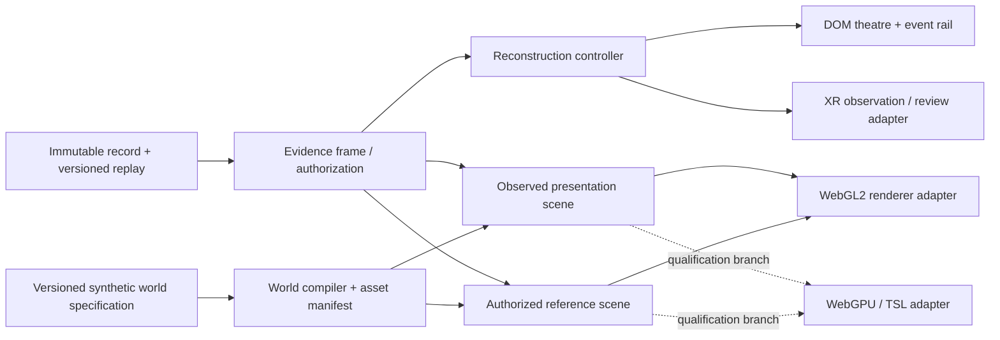

# World-class UI and 3D: a coherent transformation

Companion research: [Simulation Transformation](SIMULATION-TRANSFORMATION.md); product sequencing is consolidated in [Transformation Roadmap](TRANSFORMATION-ROADMAP.md).

Research date: 24 October 2026. Source checkout: `feature/vyuha-next-generation`, HEAD observed during research `72e0baa53cdc`; concurrent uncommitted work is not a frozen release. Methods: selective implementation inspection, primary documentation/source/license review, and actual NASA Eyes browser interaction. This extends `CONTINUATION-2026-10-23-B.md`; it does not repeat its Three clipping demo, Open MCT source study, or claim those earlier proposals are new inventions. No runtime changes, benchmark, package installation, imported artwork or headset test were performed by this research workstream.

## Decision

Build **Evidence Reconstruction Theatre** first: a scene-led debrief where a trainee can revisit a decision through the evidence available at the time, inspect the subsequent outcome, reveal the authorized world explanation, and begin a fresh practice episode addressing the same reasoning difficulty. The selected subject, temporal boundary, perspective and provenance form one workspace. The same model later drives instructor choreography, guided Academy episodes and an XR tabletop review.

The complete experience is a **Level 4 product transformation** because it replaces the current traversal between separate replay, decision, timeline and learning surfaces with one reconstruction task. A synchronized slider or another evidence card alone is Level 2. Its first bounded implementation is a **Level 3 vertical slice** until that whole task is usable and measured. A novel adaptive reconstruction that measurably improves unseen-scenario transfer is a Level 5 research candidate, not a benefit we can claim from the interface.

Keep the current WebGL2 renderer for the first slice. Introduce a renderer-independent presentation contract now; evaluate WebGPU/TSL against that contract later. This is a sequencing decision after comparing replacement architectures, not a ceiling on graphics ambition.

## Actual current system: preserve the strong parts, replace the weak composition

| Inspected implementation | Existing strength | Current gap and implication |
|---|---|---|
| `client/src/App.tsx`, review workspace | Immutable replay reconstructed from scenario, events, commands, tick and event-order boundary; overview/observer/follow camera; timeline, Ghost and decision path already select events | AAR is a collection of sections. The replay scene is explicitly reference truth while decision evidence is independently pinned. Users must mentally reconcile distinct times and perspectives. The new unit should be one reconstruction episode, not another review section. |
| `client/src/Ghost.tsx`, `types.ts` | Evidence is recorded immediately before a decision; tick labels, reason codes, command context and available-evidence scope exist | Textual explanation and spatial replay are not yet one legible moment. Preserve immutable evidence, make time divergence explicit and make the corresponding scene inspectable. |
| `client/src/Scene.tsx`, `visibility.ts`, `render-contacts.ts` | Observed poses gate camera framing and visible shape; short holds never follow hidden truth; close-up recognition is gated; truth review is labelled | These are valuable presentation boundaries. A cinematic camera must not quietly become a better sensor or reconstruct details absent from evidence. The theatre needs separate evidence/reference adapters. |
| `client/src/world/Environment.tsx`, `kit.ts`, `assets.ts` | Metric batched architecture, instanced props/foliage, local photographed skies and PBR maps, thermal twins, deterministic procedural textures; assets bundled offline | Art direction is encoded inside a monolithic world build. Richer worlds need an authored scene specification, asset budgets and reusable composition. Material/shader warm-up and geometry assembly remain independent synchronous costs. |
| `client/src/world/terrain.ts`, `obstruction.ts` | The ground is deliberately flat within 1700m; authoritative boxes and decorative obstruction have different roles | Terrain realism inside the observation volume cannot be added as decoration that implies new physical occlusion. The next world compiler must make visual/authoritative agreement explicit. |
| `client/src/VRWorld.tsx`, `VRCockpit.tsx` | Native per-eye rendering and observed-only contacts; shared environment and accepted action path; deliberate exclusion of browser optical inspection passes | XR should become a comfortable spatial learning room with shared semantics, not a floating copy of every DOM panel. Live XR and reference review need distinct presentation policies. |
| `client/src/world/materials.ts`, `Scene.tsx` | Existing custom ground/foliage material hooks and explicit layered rendering solve application-specific problems | Two `onBeforeCompile` paths and manual render/clearDepth behavior are real migration work. Replacing the renderer cannot be assessed by whether a stock cube loads. |

The source audit is not a fresh visual review of every VYUHA screen. Current screen judgments need before/after browser tasks and representative captures. Existing foundations should not be described as absent to inflate the proposal.

## What the strongest achievable experience looks like

### One visual language, different tasks

The central visual object is the exercise world. Supporting surfaces explain the selected moment. Use a restrained, authored environment palette: warm material surfaces, cool instrument light, clear depth separation and sparse high-value labels. Reserve semantic colors for observation states and evidence provenance; never encode them only by color. Replace repeated dashboard chrome with consistent spatial hierarchy and deliberate changes of density.

- **Training Ground:** scene and optical instrument dominate, with a stable subject/evidence strip and compact action area. Sensor loss changes observation content, not the location of core controls. Start with an authored arrival/briefing shot, then a stable sensor view; motion may be reduced or skipped.
- **Reconstruction Theatre:** a scene stage, integrated event rail and a fixed evidence/decision column. On wide displays, evidence and spatial reference may be compared side-by-side; on smaller displays, a clearly named perspective switch keeps one active canvas. Never require two full world renderers merely to achieve a split-screen aesthetic.
- **Instructor mission control:** the same exercise graph becomes a rehearsal conductor: objectives, scheduled interventions, observability windows and trainee-visible state are linked to time. Preview exactly what the trainee can know before publishing a scenario. This changes authoring from a form of parameters to a teaching sequence.
- **Academy:** short guided simulation episodes culminate in a decision and reconstruction, then a fresh variant. Course navigation remains available, but a lesson is an activity in the simulator rather than a dashboard of reading panels.
- **Analytics:** drill into a skill claim to the specific decision, available evidence and comparison conditions. Show evidence coverage and variation across unseen scenarios. A more beautiful chart does not make repeated exposure a transfer measure.
- **XR:** a seated/stationary observation station and optional review tabletop, with one active evidence focus and readable movable instruments. Desktop and XR share meanings and accepted payloads; composition, scale and input differ.

These surfaces must share selection, time and perspective. Re-theming six independent screens would not achieve this target.

### Authored graphics rather than indiscriminate effects

The visual upgrade should be visible at the first glance: stronger silhouette and scale composition, coherent material response, contact shadows, physically plausible sky/ground lighting balance and atmospheric depth. Create two high-quality original synthetic environment kits before generating many weak variations. Each kit needs terrain outskirts, compound architecture, utility dressing, vegetation, weather/light presets and low/medium/high representations from one asset manifest.

Use camera/lens effects only when their semantics are honest. A display crop is not increased sensor resolution. Depth of field, bloom, film grain and temporal reconstruction can erase or fabricate tiny contact cues; isolate them to briefing/reference cameras until a perception task establishes equivalence. Live optical imagery should have a controlled exposure/contrast policy and documented synthetic degradation, rather than arbitrary cinematic postprocessing. Thermal imagery remains a declared educational display model, not a physical radiometry claim.

World detail belongs in stable reusable assets and bounded batches first. Rain streaks, vegetation motion and dust can communicate a synthetic condition, but they should use a separate seeded presentation clock. Pausing or seeking must not produce a different assessed observation. Decorative particles must not become extra evidence about an otherwise unavailable contact.

## Primary references: what was actually inspected

| Reference and method | Established fact / transferable idea | Limits and reuse |
|---|---|---|
| [NASA Eyes on the Solar System](https://eyes.nasa.gov/apps/solar-system/#/home), actually rendered and interacted with; [NASA description](https://www.nasa.gov/interactives/) | A large central spatial scene, subject navigation, contextual tools and visible time control make temporal exploration tangible. Receipt below records the actual controls and a temporal-context reset worth avoiding. | No NASA scientific fidelity, learning benefit or performance transfers to VYUHA. Independently design the workflow; do not copy artwork or imply endorsement. [NASA media guidance](https://www.nasa.gov/nasa-brand-center/images-and-media/) has branding and third-party exceptions. |
| [X-Plane 12 manual](https://www.x-plane.com/manuals/desktop/), documented workflow, not executed | Replay stores state rather than only a video, permitting different camera views; an Instructor Operator Station supports scenario interventions and a second display. | This validates a working product pattern, not a VYUHA educational outcome. Proprietary product; no interface/artwork imported. |
| [Unreal Sequencer](https://dev.epicgames.com/documentation/unreal-engine/sequencer-cinematic-editor-unreal-engine?lang=en-US), documented editor | Temporal tracks and camera cuts allow an authored explanation to be orchestrated as one sequence. Apply the idea to evidence chapters with explicit boundaries. | A cinematic sequence is not evidence. Keep explanatory camera choreography separate from immutable session history. Unreal is under its own [EULA](https://www.unrealengine.com/eula/unreal), not a permissive library. |
| [Three WebGPURenderer guide](https://threejs.org/manual/pages/webgpurenderer), primary migration documentation | The renderer can target WebGPU or WebGL2; TSL/node materials and the new post stack require migration from custom GLSL hooks. | Documentation still identifies experimental gaps and possible cases where WebGLRenderer performs better. A fallback backend does not automatically preserve this application's materials, passes or XR behavior. |
| [Three r180 XRManager source](https://raw.githubusercontent.com/mrdoob/three.js/r180/src/renderers/common/XRManager.js), version-pinned code | This version explicitly supports XR through the WebGL2 backend. | Current documentation and newer XR/WebGPU demos cannot qualify the locally installed r180 path. Test browser and physical headset separately. |
| [WebGPU browser implementation report](https://web.dev/blog/webgpu-supported-major-browsers), platform-owner documentation | Browser API availability now spans major vendors but varies with OS/GPU/version. | API support is not an M1 workload or headset benchmark. Probe actual adapter/features and keep an explicit supported-browser matrix. |
| [Epic Mac rendering feature table](https://dev.epicgames.com/documentation/unreal-engine/macos-development-requirements-for-unreal-engine?lang=en-US), vendor requirements | Software Lumen is listed for M1+, while Nanite/VSM require M2+ beta support; hardware-ray Lumen is not supported in that table. | M1 is a concrete constraint. Replacing the web app with Unreal does not unlock every headline UE5 technique on this machine. No Unreal executable was run. |
| [glTF Transform](https://gltf-transform.dev/) and its [MIT license](https://github.com/donmccurdy/glTF-Transform/blob/main/LICENSE.md), tooling/docs/license | Build-time optimization, simplification and texture processing can improve delivery while keeping runtime scene composition portable. | Choose per-asset tolerances; compare silhouettes, alpha edges and tiny contact visibility. Tool license does not license input assets. |
| [Three KTX2Loader](https://threejs.org/docs/pages/KTX2Loader.html), loader contract | Transcoding chooses a hardware-supported compressed texture format and requires local JS/WASM support files and renderer support detection. | Bundle and precache transcoders; verify cold/offline decode and memory on each target. WebP download savings are not GPU texture memory savings. |
| [OGC 3D Tiles standard](https://www.ogc.org/standards/3DTiles/), [specification](https://docs.ogc.org/cs/22-025r4/22-025r4.html) and [Cesium tileset API](https://cesium.com/learn/cesiumjs/ref-doc/Cesium3DTileset.html) | Hierarchical spatial content and screen-space error support progressively detailed worlds. Cesium exposes a view-dependent cache and overflow tradeoff. | Borrow the bounded hierarchy principle for local synthetic tiles; a global geospatial engine/service is not required. Dataset/service licenses differ from the open format. |
| [3D Gaussian Splatting paper](https://arxiv.org/abs/2308.04079) and [reference implementation license](https://raw.githubusercontent.com/graphdeco-inria/gaussian-splatting/main/LICENSE.md) | Captured radiance fields can make compelling novel-view scenery. | Captured appearance does not automatically provide editable semantic geometry, new lighting or physical occlusion. The reference implementation is research/evaluation restricted, not blanket commercial permission. It is an investigation branch, not the default world pipeline. |
| [Immersive lab study](https://doi.org/10.1016/j.learninstruc.2017.12.007) and [W3C XAUR](https://www.w3.org/TR/xaur/) | One controlled study found greater presence with worse learning/cognitive load in its VR condition; XAUR documents multimodal and motion-agnostic user needs. | The study is not a universal anti-VR result; XAUR is a Working Group Note, not certification. Evaluate the actual instructional task and physical device. |

Three core itself is [MIT-licensed at r180](https://raw.githubusercontent.com/mrdoob/three.js/r180/LICENSE). Asset, decoder, font and dependency notices remain separate. Reference products establish ideas and constraints; none of their protected layouts, branding or art should be copied.

### Executed interaction receipt: NASA Eyes, 24 October 2026

A dedicated Chrome research tab (`1027395528`) loaded the public NASA/JPL application. IAB creation was unavailable in this agent's browser inventory; Chrome was used after the parent completed performance traces. No account, upload, user data, browser setting, viewport override or third-party submission was involved.

1. Rendered solar system with orbit traces, labelled subjects, story cards and visible REAL RATE/LIVE state.
2. Expanded time controls, selected Pause: visible heading became PAUSED, URL recorded `rate=0` and a time.
3. Increased rate: heading became 3 SECS/S, slider value changed from50 to51 and URL recorded `rate=3`.
4. Menu → Earth changed the selected subject and camera to a globe with contextual Info/Toolbox/View Options.
5. View Options → Nearby selected its radio and visibly reframed Earth. Screenshot showed surface detail, camera choices and orbit-layer controls.
6. Important negative observation: Earth navigation removed the earlier rate/time query and returned REAL RATE/LIVE. Do not copy that behavior for evidence review. Selection must preserve the reconstruction boundary.

Screenshots were observed in the tool transcript; no local evidence image was saved. AX indices became stale on the animated page; a semantic radio locator succeeded. The final globe screenshot visibly contained dense overlapping orbit/label lines: selective layers matter more than copying the visual density. The tab was closed to release GPU resources. This receipt proves control-to-state/render interaction only; no FPS, scientific, accessibility or learning acceptance is implied.

## Renderer and world architecture alternatives

| Candidate | Strongest target and practical advantage | Migration cost / boundary | Decision |
|---|---|---|---|
| Evolve existing WebGL2 + authored glTF/PBR pipeline | Deliver theatre, new world kits, better lighting and bounded effects offline with existing browser/XR behavior | Separate scene data/material/camera policies from React world construction; build asset budgets; retain current sensor gates | **First implementation path.** This can produce a conspicuous experience change without coupling it to engine replacement. |
| Three WebGPURenderer + TSL | Portable material graph, modern compute and render pipeline; optional richer atmosphere and indirect lighting on capable targets | Port both material hooks, thermal twins, inspection/multipass semantics, renderer initialization, resource/disposal and XR fallback. Compare pinned versions. | **Dedicated renderer spike after theatre contract.** Promote only on matched visual correctness, interaction latency, memory and device results. |
| Procedural synthetic world compiler + local tile hierarchy | Many authored-quality settings with deterministic seeds, prebuilt LODs and bounded loading; renderer independent | Compile visual dressing and authoritative volumes from a versioned common scene specification. Build graph dependencies and cancellation/eviction. | **Target architecture for Level4 world upgrade.** Start with one kit and a bounded local area; avoid globe/cloud dependency. |
| Unreal native client or streamed rendering | Much richer authoring/cinematic tooling and a possible specialist installed training edition | New delivery/runtime/input/accessibility/record adapter; licensing, asset restrictions, Mac feature limits; streaming conflicts with offline needs | **Alternative product edition only**, if a measured requirement exceeds web capability and budget supports two clients. Do not rewrite the working offline platform on a visual impression. |
| Captured Gaussian splat environment | Visually striking contextual scenery | Lighting/thermal/semantic/occlusion/editability/licensing and stereo costs need independent solutions | **Level5 research branch**, optional backdrop in authorized review. Never the authoritative observation scene without validation. |

A renderer upgrade is not the only way to remove current limits. A source-independent scene compiler and a stable presentation frame make both a high-quality WebGL client and a later WebGPU client feasible.

## Target architecture and migration

1. **Extract the temporal/perspective contract.** Keep session ID, selected decision/contact, cursor tick plus event-order boundary, evidence tick, sensor channel and perspective together. Preserve a deliberately pinned decision while the playhead moves and label the divergence. Unknown or unsupported records fail to textual reconstruction with a reason.
2. **Build theatre as the review composition.** Adapt existing Ghost evidence, timeline and Scene. Use one active canvas first. Read-only reconstruction cannot dispatch live classification/response commands. Reference-truth reveal is an explicit review action with persistent semantics.
3. **Create an authored environment specification.** Move style/kit/light/atmosphere choices out of the monolithic build; keep physical observation volumes separate but linked. Version and hash assets/settings. Add one materially better environment with matched semantic fixtures.
4. **Compile and budget.** Static terrain/structure meshes and baked non-authoritative lighting can be prepared at build time; reuse material atlases, instantiate repeated props, bound tile count and cancellation. KTX2/mesh compression must ship local decoders and preserve the offline manifest.
5. **Port presentation to XR.** Share evidence/time/action meanings; use medium-specific framing. Require stationary operation, reset/recenter, alternative inputs and complete-task headset checks. Do not port browser crop/inspection tricks to per-eye geometry.
6. **Qualify another renderer.** Feed the same recorded fixtures to WebGL2, WebGPU and fallback. Keep current renderer until a specific measured advantage survives mode transitions, optics, scene restoration and device loss.

## First vertical slice the implementation team can build now

**One decision, two justified perspectives, one time boundary.** On selecting a decision, place the trainee in an integrated reconstruction stage at that decision's pre-action tick/order. The scene initially uses observed-only presentation and the evidence column uses the immutable decision evidence. A perspective control reveals the authorized world-reference view, changing the label and composition together. An event rail steps to relevant earlier/later moments; selection changes retain temporal context unless the user explicitly jumps to the new decision. End at one clearly identified next-practice objective through the existing preparation path.

Suggested ownership: new `client/src/reconstruction.ts` for pure presentation state/selectors and `client/src/ReconstructionTheatre.tsx` for composition; adapt the review region in `App.tsx`, reuse `Ghost.tsx`, `Scene.tsx`, `visibility.ts` and existing replay functions. Keep renderer/material changes out of this first slice. New source names are proposed seams, not claims that code already exists. Any replay reconstruction cache must key immutable record identity/version and tick/order, not camera frame time.

### Measurable user delta and acceptance

| Question | Measurement / proposed acceptance |
|---|---|
| Can a user correctly distinguish what was known from what happened? | Matched five-question reconstruction task; record wrong-time/wrong-perspective answers and evidence-location time. Provisional product target: at least25% lower median task time with no increase in either error type. Establish baseline before claiming improvement. |
| Does every view describe the same moment? | Fixtures for same-tick multiple actions, seeks backwards, evidence gaps, ended contacts, channel changes and session switches. Zero future-observation or cross-session pose leaks; correct event-order boundary; persistent time/perspective labels. |
| Is the workflow visibly more coherent? | A first-time user completes select→reconstruct→explain→next practice without searching another review section. Test keyboard, pointer and reduced-motion paths. Record task completion and panel transitions, not preference alone. |
| Is graphics quality higher without corrupting the task? | Named baseline/candidate captures and a tiny-contact observability task across all quality modes; no cue appears/disappears due solely to new aesthetic processing. Review-only effects remain isolated. |
| Does the experience remain responsive? | Fixed M1/browser/viewport/tier/session, cold/repeat startup, seek latency, input p95, frame tails, resource counts and memory after repeated entry/exit. Provisional seek target p95<150ms for the bounded first slice; any baseline breach needs a measured explanation. No median-FPS-only acceptance. |
| Is offline/XR preserved? | Browser offline first/repeat entry and all local asset/decoder requests; XR enter/exit/re-entry, observed-only parity, per-eye occlusion, physical target/text readability and comfort on named hardware. Emulator does not close the headset gate. |
| Does it teach better? | Controlled unseen-variant test and delayed retention study, reporting uncertainty. Presence, engagement, preference and synthetic score are separate outcomes. No learning claim from a successful browser task alone. |

R01 startup work remains separate evidence. Parent-reported chunked-candidate results are not reproduced or generalized here; default renderer/texture policy and pending optics/XR gates must be taken from its own source-bound receipt. This document adds no capability count or release claim.
