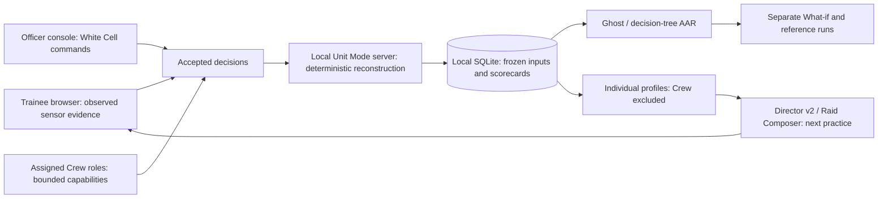

# Finale presentation source handoff — candidate only

Team WhiteList&0 · Team ID 185350 · SIH26247 · Software. This is editable source material, not a final competition deck or validated release. Final PPT/PDF/video must wait for mandatory release acceptance. Use evidence.json and FINAL-RELEASE-GATES.json as the current authority.

## Demonstration story

Observe → Decide → Verify → Explain → Adapt → Train again. Show trainee sensor evidence first, then an accepted decision and server verification. Open Ghost and the decision tree, branch one recorded response with What-if, and keep the original score visible. Use an evidence-only reference to explain abstention when type or intent is unknown. Show Director v2 selecting the next skill from the persistent profile; call its target a heuristic, not a measured learning improvement.

In a second short sequence, show the officer's White Cell command and the shared Crew spotter → responder workflow. End on persisted role attribution and a shared score, explicitly separate from individual learning. Show expiring codes and officer revocation with synthetic assignments. Finally show the locally served assets and current evidence/compliance board.

## Six-slide source structure

1. Problem and solution: repeatable counter-drone decision training; VYUHA demonstration identity and a real UI screenshot.
2. Training loop: observed evidence, classification uncertainty, response selection, server verification, Ghost and next practice.
3. Architecture and novelty: local services/assets, deterministic Python/TypeScript parity, frozen scenario/event evidence, Crew and White Cell, Fusion as inspectable advice.
4. Feasibility and proof: current combined regression counts, exact historical preservation, measured M1 rendering and paired reconstruction workload. Include scope and dates, not an unlabeled certification badge.
5. Benefits and implementation: rehearsal/after-action traceability, deployment workflow, officer management and transfer integrity. Human learning outcomes and operational calibration require studies.
6. References, limitations and next acceptance: direct compliance proof and physical/native runbook; research/data handoff with provenance and explicit synthetic/real separation.

## Rehearsal and judge questions

- Why can RF jamming fail? Explain the simulated no-RF contact rule and available evidence; do not infer hostile identity from an IFF non-response.
- Is Ghost a military expert? It is a deterministic, inspectable training policy and rubric reference, not a certified expert or optimal operational policy.
- Does Director improve learning? The experiment did not establish improved learning outcomes. Its seeded profile selection and metadata persistence are tested.
- Is the current Finale build physically offline-certified? Historical multi-device LAN evidence and the team's historical WAN report are separate. Fresh Finale physical LAN/WAN/HTTPS and native Windows/Linux are pending.
- Are Crew scores individual competence? No. Shared outcomes and descriptive coordination remain separate from individual profiles.
- Is every audit finding complete? No. The current scoped counts and provisional independent score are in the evidence manifest; no final stable score exists.

## Demo preparation

Use synthetic identities and dedicated disposable data. Prepare one frozen Raid Composer exercise and two assigned roles, plus one completed individual AAR with Fusion receipts. Choose seeds from actual saved current exercises; do not invent a guaranteed successful score. Record the exact code commit, source hash and asset cache before rehearsal. Avoid role codes, passwords, personal data and databases in screenshots or exported submission files.

After external tests, rerun changed-source checks, reconcile the independent audit, seal the release receipt, then create the approved stable tag. Build final media from that tag and record two playable local video copies. Until then, use this source handoff for planning only.
