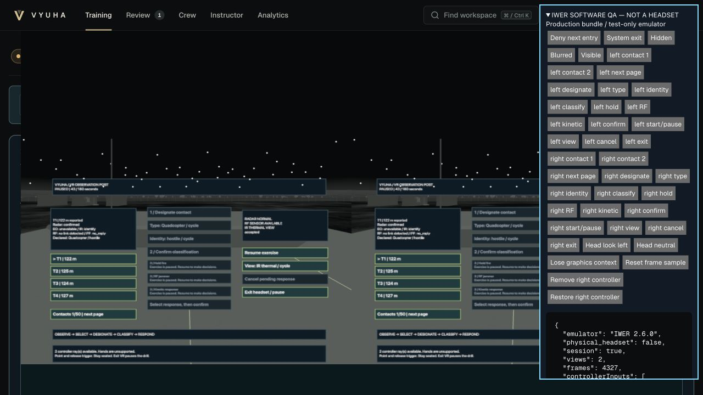
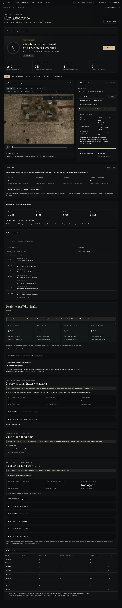

# Browser + VR integration — owner-review handoff

Runtime source: **`ad430f742f7476feb464c1c53d08cfb3f95823ba`**, branch `integration/vyuha-browser-vr-unified`. Policy `vyuha-source-inputs-v2`: **`f87104f832e9cb9b03ad18ab3938a23a1a43f1bc51ba95385f540c684c36534a`**. Documentation/evidence is committed afterward; its Git commit is the evidence envelope, not a different tested runtime. The adjacent [source manifest](evidence/source-inputs.json) identifies every measured input.

**Status: functional software acceptance is recorded below. Stress-startup frame stalls remain a measured performance limitation; owner approval and physical acceptance remain required. No RC, stable tag or merge into the accepted browser branch is authorized or created.** All scenarios, sensor parameters and response effects remain illustrative training models. No learning-efficacy improvement or operational calibration is claimed.

## Recovered and corrected

The interrupted worktree was recovered at `0e5634403854df213dea93bf1ad325bf4f8e7d6b`, preserving its modified files, untracked attribution ledger/tests and external QA records. No reset, clean, branch replacement or database overwrite occurred.

| Issue | Resolution and exact source | Proof |
|---|---|---|
| Fusion advice selected at acknowledgment could belong to a later display/context | `bdb34e215063b40dbff430247a4a4417626de50c`: `client/src/action-evidence.ts`, `App.tsx`. Capture a deep-cloned advice/confidence snapshot at dispatch; consume only the matching scope, request ID and action payload, once. VR captures no browser-only advice/confidence. Clear ownership on new/restored sessions. | [Two actual-App regressions reproduced the old failure](evidence/fusion-race-reproduction.log); [29 targeted tests pass](evidence/dispatch-and-choices-regression.log), included in final 367. Ledger tests cover mismatches, absent IDs, duplicate/out-of-order replies and reset. |
| VR inherited preselected type/identity | Same commit: `VRCockpit.tsx`, `vr.ts`. Fresh contacts require both explicit selections; ordinary snapshots preserve unsent choices. Contact/session changes reset choices; re-entry hydrates only the trainee's recorded classification/declaration. | Actual cockpit DOM regression covers both choices, rapid contact change, delayed reply, session reset, remount and stored answers. Real two-controller walkthrough confirms disabled classification after type-only input. |
| Cockpit remount could lose its in-flight latch | Same commit: App's pending receipt also blocks new VR submissions across unmount/re-entry; a synchronous local latch prevents same-frame duplicates. | Expanded DOM regression; actual-App stale rejection and cross-modality tests. |
| Graphics-loss QA control targeted the pre-XR canvas container | `7d48d80`: `scripts/serve-vr-qa.py` targets the actual Three canvas after IWER reparenting. This is test-only tooling. | Real context loss then produced product pause, cleared confirmation, ordinary browser recovery and XR re-entry. Initial no-op attempt is not counted as a pass. |

Additional final-source closures:

| Issue | Resolution | Evidence |
|---|---|---|
| An unknown, duplicate or payload-mismatched worker reply could still enter the accepted action stream | `ad430f7`, `client/src/App.tsx`: return before changing feedback, persisted actions or Fusion when the dispatch ledger does not own the reply | [Two actual-App failures reproduced before correction](evidence/unowned-receipt-reproduction.log); final 29 targeted /367 full frontend pass |
| Enter VR could be pressed before the real renderer existed | `d737cc6`, `VRCockpit.tsx`: entry remains disabled with preparation feedback until renderer/lifecycle readiness | [Actual DOM failure before correction](evidence/renderer-ready-reproduction.log); readiness regression and real final-source entry pass |
| Narrow premium controls overflowed the viewport | `d5eaa08`, `styles.css`: scoped wrapping/sizing wins over premium button rules, without hiding controls | Final-source390/768/1440 CSS-pixel checks, keyboard paging and axe receipts in [browser acceptance](BROWSER-ACCEPTANCE.md) |
| Test harness overlapped asynchronous controller trigger edges | `d737cc6`, `serve-vr-qa.py`: serialize its QA ray sequence; operator verifies acknowledgments between dependent actions | Final-source IWER trigger workflow; product in-flight and duplicate locks tested separately |

The authoritative Python/TypeScript engines, shared worker, browser Scene, aircraft renderer, Environment and response model are byte-identical to the protected browser baseline. No hidden identity, true geometry, scoring rule or recorded scorecard was changed by these fixes.

## Exact-source software acceptance

| Gate | Result | Evidence / scope |
|---|---|---|
| Full backend | **PASS — 712 tests**, zero failures | [Backend log](evidence/backend.log), 586.64 seconds; one upstream Starlette/httpx deprecation warning. |
| Full frontend | **PASS — 367 tests**, zero failures | [Frontend log](evidence/frontend.log). Earlier 360/29 counts are checkpoints, not substitute final totals. |
| Python/TypeScript parity | **PASS** | Full frontend includes 544 Finale, 288 response, 1,920 sensor and 135 advanced checkpoints, rural54, all12 Director templates, original engine/ordered instructor parity and all8 raid motion families. See named test lines in the full log. Checkpoints are not additional test totals. |
| Historical compatibility | **PASS — original18 and stored22 unchanged** | [18 receipt](evidence/historical18.json), [22 receipt](evidence/historical22.json), [log](evidence/history.log). Read-only source backup; original aggregate digests recovered uniquely; cards, verified AAR and profiles preserved. |
| TypeScript, lint, formatting, production build | **PASS** | [Build](evidence/build.log), [lint](evidence/lint.log), [format](evidence/format.log), repeated from clean GitHub clone. Existing large-chunk warning remains; lazy-loading retained. |
| XR contracts and lifecycle | **PASS — software scope** | Capability denial/retry, pending entry disposal, concurrent-entry suppression, tracked-controller filtering, two-eye rendering, both rays, paging, view/head changes, input removal/restoration, exit/re-entry, visibility pause and context-loss recovery. Unit/DOM tests plus actual IWER browser screenshots/receipts below. |
| Complete VR training + Ghost | **PASS** | Final runtime uses test-only IWER2.6.0. Final-source200-contact session `e30a911c-7a2c-467e-8fae-9c3f58787638` exercises both controller rays and explicit choices. Final-source authored session `1d823417-5fbb-4da1-adde-ecd4b824faed` contains three ordinary-browser decisions and three desktop-cockpit decisions; only browser orders0–2 have Fusion associations. The200-contact XR session naturally reached5,400ticks and Server verified/Ghost after deliberate context loss, browser recovery and re-entry; [current capture](evidence/browser/owner-xr-server-verified.png). Lifecycle receipts are indexed in the browser acceptance report. No emulator code is in dist. |
| Instructor / White Cell | **PASS — local server/browser** | Final-source radar degradation and restore both APPLIED atT+42.93s in the active XR session. [Screenshot](evidence/browser/owner-instructor-applied.png), [DOM](evidence/browser/owner-instructor-applied.txt). Earlier teaching-pause/session-isolation walkthroughs remain checkpoint evidence; final full suites revalidate command contracts. |
| Crash recovery / Fusion | **PASS — real process termination** | Final-source controller-owned server child exited **-9**. Six ordinary-browser decisions and six Fusion receipts queued, resynchronized and completed as verified session `a203d2ee-23db-49cb-87ad-ea5d1c4ed7fc`. [Crash receipt](evidence/browser-fusion-crash-final.json), [verified AAR](evidence/browser/owner-outage-verified.txt). Earlier XR-active process crash evidence is retained with its earlier runtime provenance. These are process outages, not physical WAN-off tests. |
| Context loss / browser recovery | **PASS — software scope with emulator caveat** | Armed response canceled, drill paused, XR ended, new renderer re-entered, ordinary browser accepted Hold, early completion verified. [Final-source loss](evidence/browser/owner-xr-context-loss.txt), [re-entry](evidence/browser/owner-xr-reentry.txt). IWER logged its known `onDeviceFrame` null-reading exception during deliberate context loss; [final raw status](evidence/browser/owner-xr-context-status.json) retained. No unrelated exception is waived. |
| Crew roles, security, history and learning isolation | **PASS** | Earlier separate real Spotter/Responder tabs accepted exactly3 attributed actions; active wrong-role requests403. Final-source recheck retains those three roles, shared outcome, completed-action409 denials, anonymous401 denials and unchanged individual learning. [Current HTTP receipt](evidence/crew-history-recheck.json), [current history UI](evidence/browser/owner-crew-history.txt), [original active-role receipt](evidence/crew-live.json). Expiry/revocation/retry remain in final suites. |
| What-If / evidence-only reference | **PASS** | Final-source real-browser RF branch and separate evidence-only conservative reference completed. [UI](evidence/browser/owner-replay-immutable.txt), [before/after table hashes](evidence/replay-immutability.json). Sessions, actions, commands, notes, profiles, Fusion and Crew attribution unchanged. Reference generated11 decisions; original0/100 preserved. No efficacy claim. |
| Analytics | **PASS** | Stale officer session correctly returned to sign-in after server restart. Authenticated Analytics showed individual evidence and excluded shared Crew from individual learning. [Final-source screenshot](evidence/browser/owner-analytics.png), [DOM](evidence/browser/owner-analytics.txt). |
| HTTPS, authorization, Transfer/Restore | **PASS — loopback software scope** | [Fresh retest](evidence/https-transfer-restore.json): 11 portable synthetic sessions,24 Fusion receipts, two notes, completed Crew (seven historical fixture sessions plus complete unchanged histories of two live QA trainees); exact forward payload; duplicate/tamper protection; backup/restore;144 negative requests across36 protected route/method pairs. CA trusted only inside the test SSL context; system/browser trust untouched. Two included sessions were recorded on this final runtime; the other histories are fixtures reconstructed afresh. [Fixture provenance](evidence/portable-fixture-provenance.json) records the correction of an initially incomplete test fixture. Its first exact-payload comparison failed because accumulated profiles included omitted sessions; copying the complete original histories resolved it without product/test weakening. |
| Nonportable benchmark fixtures | **EXPECTED REJECTION** | Deliberately seeded rendering workloads are not authored portable raids. An initial export/import attempt rejected their schema with422; no validator was weakened and no record rewritten. They are excluded from portable-history acceptance and training-efficacy claims. Their separate live action/recovery evidence is retained. |
| Docker | **PASS — ARM64 Docker on M1** | [Build](evidence/docker-build.log), [runtime](evidence/docker-runtime.json): health200, all75 production files match local build; loopback binding only. Container stopped after checks. This does not certify native Linux/headset execution. |
| Offline assets / clean clone | **PASS** | Fresh GitHub clone of exact runtime SHA; clean dependencies;367 frontend and35 startup tests; lint/format/build; **all75 production files byte-identical**. [Receipt](evidence/clean-clone.json). No IWER asset is shipped. First installation still requires dependencies; no cloud service is required during training. |
| Desktop/XR performance | See [measured performance](PERFORMANCE.md) | M1 only; browser and emulated stereo results separated. No physical headset FPS claim. |
| Responsive/native keyboard controls | See [browser acceptance](BROWSER-ACCEPTANCE.md) | Real viewport/keyboard receipts supplement final accessibility and cockpit DOM regressions. Headset ergonomics remain pending. |

## Visual evidence





These are actual final-source browser captures. IWER is software emulation, not headset footage. The `owner-*` receipts identify final `ad430f7` capture state; generic older filenames remain checkpoint evidence and are explicitly indexed by source in [browser acceptance](BROWSER-ACCEPTANCE.md). They are not relabeled as final captures. The authoritative final tests, manifests, transfer/history and clean-clone receipts all identify final source independently.

## Acceptance interpretation

The reproduced unification correctness defects are closed by the final runtime and regression/browser evidence. Performance is **MEASURED WITH LIMITATIONS**: warm samples are documented, while startup/transition stalls remain an open finding. They are not hidden by the60FPS median or silently declared fixed. Owner review must include startup and decide whether that behavior is acceptable before any release-candidate approval. No additional rendering-pipeline changes were introduced after testing.

The feature manifest, operator/VR guide and optional demo/PPT addendum distinguish experimental software from physical validation. [Software totals](evidence/software-results.json), [all evidence hashes](EVIDENCE-MANIFEST.json), [browser provenance](BROWSER-ACCEPTANCE.md) and [performance](PERFORMANCE.md) provide the handoff record. No provisional historical audit score is presented as a new final score.

## Protected state and remaining release gates

- Accepted browser branch stays `259c50acdc5373a7971e9885b1232645edf23466`. The demo developer's work is untouched. Original owner dirty files remain preserved in their separate worktree.
- `release/v1.0.1`, tags `v1.0.1`, `v1.1.0-rc.1`, `v1.1.0-rc.2` and the historical VR branch are preserved. [Protection receipt](evidence/protected-state.json) records checks against the recovery snapshot.
- **PENDING:** owner review/approval of polished unified live application; physical headset operation, comfort, controller ergonomics, headset FPS; separate-device trusted LAN HTTPS; final-candidate native Windows/Linux/Android, physical LAN/WAN-off acceptance. Historical team confirmations do not certify this source.
- **Limitations:** stationary experimental controller-ray cockpit; hand-only input unsupported; modern IR night is styled IR, not separate NV hardware; Fusion/confidence display is browser-only. No operational sensor/threat/weapon calibration, certified military expert or controlled learning-efficacy evidence. Emulated rendering and browser heap counters are not headset/GPU/total-process measurements.
- The feature manifest's older release fields remain historical. The new `vr_unification` scope and VR row link to this report; earlier audit scores are not rerated or promoted into final acceptance by test totals.

## Run on this Mac

For a fresh owner workspace, without touching any previous database:

```bash
cd '/Users/seemalanaveenyadav/Desktop/SIH/vyuha/work/finale/ultimate-experience/browser-vr-unified'
VYUHA_UNIT_MODE=1 VYUHA_PORT=8000 bash scripts/start-local.sh
```

Open `http://127.0.0.1:8000`. Existing dependencies are installed. The first default-data run asks you to provision your own officer password; private QA credentials are not distributed. Join a callsign, prepare Adaptive, then use Open VR observation cockpit for desktop preview. Plain desktop preview does not need a headset/emulator.

For a physical headset, use the same built source with your browser-trusted certificate/key and `bash scripts/start-vr.sh --port 8000`; follow the [VR guide](../../client/public/vr-guide.html). Never bypass certificate warnings. The loopback-only IWER harness is for software QA, not LAN deployment.

The existing cinematic demo/PPT may retain its protected browser source. The [optional VR addendum](DEMO-AND-PPT-ADDENDUM.md) supplies captions and a verified short capture sequence without changing that project.
